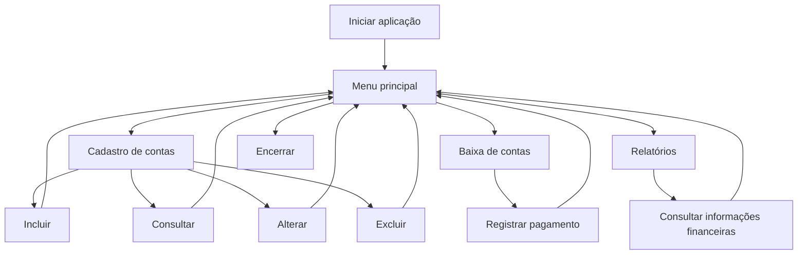
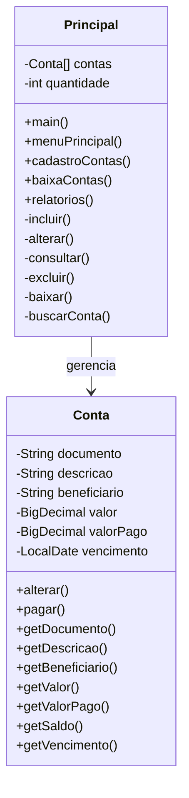

<div align="center">

# 💰 Sistema de Contas a Pagar

### A3 — Algoritmos de Programação


**Sistema desktop para gerenciamento e controle de contas a pagar, desenvolvido em Java.**

[Sobre](#-sobre-o-projeto) •
[Funcionalidades](#-funcionalidades) •
[Tecnologias](#-tecnologias-utilizadas) •
[Execução](#-como-executar) •
[Equipe](#-equipe-de-desenvolvimento)

</div>

---

## 📖 Sobre o projeto

Este projeto foi desenvolvido como parte da avaliação A3 da disciplina de Algoritmos de Programação, do curso de Análise e Desenvolvimento de Sistemas (ADS).

A aplicação consiste em um sistema de gerenciamento de contas a pagar, permitindo cadastrar, consultar, alterar e excluir obrigações financeiras, registrar pagamentos e gerar relatórios para acompanhamento das despesas.

O sistema foi desenvolvido utilizando Java, com interface gráfica baseada na biblioteca Swing, gerenciamento de compilação com Apache Maven e versionamento de código por meio do Git e GitHub.

A proposta é aplicar os conhecimentos adquiridos durante a disciplina em uma solução computacional que simula uma necessidade real de controle financeiro.

---

## 🎯 Objetivos do projeto

### Objetivo geral

Desenvolver uma aplicação capaz de auxiliar no controle e gerenciamento de contas a pagar, utilizando conceitos de lógica de programação e programação orientada a objetos.

### Objetivos específicos

- Aplicar conceitos de algoritmos e lógica de programação.
- Utilizar estruturas condicionais e de repetição.
- Trabalhar com vetores e manipulação de objetos.
- Organizar o código em classes e métodos.
- Aplicar conceitos de encapsulamento.
- Implementar operações de cadastro, consulta, alteração e exclusão.
- Desenvolver mecanismos de validação de dados.
- Realizar cálculos financeiros com precisão decimal.
- Manipular datas e períodos.
- Desenvolver uma interface gráfica de fácil utilização.
- Praticar o desenvolvimento colaborativo.
- Utilizar ferramentas de controle de versão.

---

## ⚙️ Funcionalidades

### 📋 Cadastro de contas

- Inclusão de novas contas.
- Consulta de contas cadastradas.
- Alteração de informações.
- Exclusão de registros.
- Identificação por número de documento.
- Validação dos campos obrigatórios.
- Controle de documentos duplicados.

### 💳 Baixa de contas

- Registro de pagamentos.
- Pagamentos parciais.
- Pagamentos integrais.
- Controle do valor original da conta.
- Controle do total já pago.
- Cálculo automático do saldo devedor.
- Validação do valor informado para pagamento.

### 📊 Relatórios financeiros

- Consulta de contas por período.
- Acompanhamento de obrigações financeiras.
- Consulta de valores por beneficiário.
- Balanço financeiro por período.
- Apresentação organizada das informações.

### 🛡️ Validação de dados

- Validação de campos obrigatórios.
- Validação de valores monetários.
- Validação de datas.
- Tratamento de entradas inválidas.
- Controle de pagamentos superiores ao saldo.
- Verificação dos limites de armazenamento.

---

## 🖥️ Interface do sistema

A aplicação utiliza componentes gráficos da biblioteca Java Swing, permitindo a interação com o usuário por meio de caixas de diálogo, menus e áreas de texto.

### Menu principal

| Opção | Funcionalidade |
| :---: | :--- |
| 1 | Cadastro de contas |
| 2 | Baixa de contas |
| 3 | Relatórios |
| 0 | Encerrar aplicação |

### Fluxo de funcionamento



---

## 🛠️ Tecnologias utilizadas

| Tecnologia | Finalidade |
| :--- | :--- |
| Java 8 | Linguagem de programação |
| Java Swing | Interface gráfica |
| Apache Maven | Gerenciamento e compilação do projeto |
| Apache NetBeans | Ambiente de desenvolvimento |
| Git | Controle de versão |
| GitHub | Hospedagem e colaboração |
| BigDecimal | Cálculos monetários com precisão |
| LocalDate | Manipulação de datas |
| DateTimeFormatter | Formatação e validação de datas |
| NumberFormat | Formatação de valores monetários |
| Markdown | Documentação do projeto |
| Mermaid | Representação visual dos fluxos |

---

## 📂 Estrutura do projeto

```text
A3_Algoritmos_e_Programacao/
│
├── src/
│   └── main/
│       └── java/
│           └── contas/
│               ├── Conta.java
│               └── Principal.java
│
├── .gitignore
├── LICENSE
├── nbactions.xml
├── pom.xml
└── README.md
```

### Descrição dos arquivos

| Arquivo | Responsabilidade |
| :--- | :--- |
| Conta.java | Representação das contas e regras de negócio |
| Principal.java | Interface, menus, operações e gerenciamento das contas |
| pom.xml | Configurações do projeto Maven |
| nbactions.xml | Configurações de execução no NetBeans |
| .gitignore | Definição dos arquivos ignorados pelo Git |
| LICENSE | Licença de utilização do projeto |
| README.md | Documentação geral |

---

## 🧩 Arquitetura do sistema

O sistema está organizado em duas classes principais, separando a representação dos dados financeiros das operações realizadas pela aplicação.

### Classe Conta

Responsável por representar uma obrigação financeira e controlar suas informações.

#### Atributos

| Atributo | Tipo | Descrição |
| :--- | :--- | :--- |
| documento | String | Identificador da conta |
| descricao | String | Descrição da despesa |
| beneficiario | String | Destinatário do pagamento |
| valor | BigDecimal | Valor original da conta |
| valorPago | BigDecimal | Total acumulado de pagamentos |
| vencimento | LocalDate | Data de vencimento |

#### Principais métodos

| Método | Responsabilidade |
| :--- | :--- |
| Conta() | Construção de uma conta com parâmetros |
| alterar() | Atualização controlada dos dados |
| pagar() | Registro de pagamentos |
| getDocumento() | Retorno do identificador |
| getDescricao() | Retorno da descrição |
| getBeneficiario() | Retorno do beneficiário |
| getValor() | Retorno do valor original |
| getValorPago() | Retorno do total pago |
| getSaldo() | Cálculo do saldo devedor |
| getVencimento() | Retorno da data de vencimento |
| validarValor() | Validação de valores monetários |
| textoObrigatorio() | Validação de campos textuais |

### Classe Principal

Responsável pela execução do sistema e pela interação com o usuário.

Entre suas responsabilidades estão:

- Inicialização da aplicação.
- Apresentação dos menus.
- Leitura das informações.
- Armazenamento das contas em vetor.
- Operações de cadastro.
- Localização de registros.
- Registro de pagamentos.
- Geração de relatórios.
- Formatação das informações.
- Tratamento de entradas inválidas.

### Diagrama de classes simplificado



---

## 📐 Regras de negócio

O sistema possui regras destinadas a garantir a integridade das informações cadastradas.

| Código | Regra |
| :--- | :--- |
| RN01 | O documento deve identificar uma conta de maneira única. |
| RN02 | Os campos obrigatórios devem ser preenchidos. |
| RN03 | O valor da conta deve ser maior que zero. |
| RN04 | Valores monetários devem possuir no máximo duas casas decimais significativas. |
| RN05 | A data de vencimento deve ser válida. |
| RN06 | O pagamento deve possuir valor positivo. |
| RN07 | O pagamento não pode ultrapassar o saldo devedor. |
| RN08 | O valor original não pode ser alterado para um valor inferior ao total já pago. |
| RN09 | O saldo devedor deve ser calculado pela diferença entre o valor original e o total pago. |
| RN10 | O documento não pode ser alterado após a criação da conta. |
| RN11 | O armazenamento está limitado a 100 contas. |

---

## 🧮 Exemplo de funcionamento

Considere uma conta cadastrada com as seguintes informações:

| Campo | Informação |
| :--- | :--- |
| Documento | 001 |
| Descrição | Internet |
| Beneficiário | Fornecedor A |
| Valor original | R$ 500,00 |
| Valor pago | R$ 150,00 |
| Saldo devedor | R$ 350,00 |

O saldo devedor é calculado utilizando a seguinte regra:

```text
Saldo devedor = Valor original - Total pago

Saldo devedor = 500,00 - 150,00

Saldo devedor = R$ 350,00
```

Caso seja registrado um novo pagamento de R$ 350,00, a conta ficará integralmente quitada.

---

## 🧠 Conceitos de programação aplicados

Durante o desenvolvimento, foram utilizados diversos conceitos estudados na disciplina:

- Variáveis e constantes.
- Tipos primitivos e tipos por referência.
- Operadores aritméticos.
- Operadores relacionais e lógicos.
- Estruturas condicionais.
- Estruturas de repetição.
- Estrutura switch-case.
- Vetores de objetos.
- Classes e objetos.
- Construtores.
- Encapsulamento.
- Modificadores de acesso.
- Métodos estáticos.
- Métodos com retorno.
- Passagem de parâmetros.
- Getters.
- Tratamento de exceções.
- Validação de dados.
- Manipulação de strings.
- Manipulação de datas.
- Desenvolvimento de interfaces gráficas.
- Documentação utilizando comentários e Javadoc.

---

## 🚀 Como executar

### Pré-requisitos

Antes de executar o projeto, recomenda-se possuir:

- Java Development Kit (JDK 8 ou versão compatível).
- Apache Maven.
- Git.
- Apache NetBeans ou outra IDE compatível com Java e Maven.

### 1. Clonar o repositório

```bash
git clone https://github.com/Vinicius-de-marco/A3_Algoritmos_e_Programacao.git
```

### 2. Acessar o diretório

```bash
cd A3_Algoritmos_e_Programacao
```

### 3. Executar pelo NetBeans

1. Abra o Apache NetBeans.
2. Selecione File > Open Project.
3. Localize a pasta do projeto.
4. Abra o projeto Maven.
5. Localize a classe Principal.java.
6. Clique com o botão direito sobre a classe.
7. Selecione Run File.

### 4. Executar pelo terminal

Compile o projeto:

```bash
mvn clean compile
```

Execute a classe principal:

```bash
java -cp target/classes contas.Principal
```

Após a execução, o menu principal será apresentado por meio da interface gráfica.

---

## 🧪 Roteiro de testes manuais

Os seguintes cenários podem ser utilizados para verificar o funcionamento da aplicação:

| ID | Cenário | Resultado esperado |
| :--- | :--- | :--- |
| CT01 | Cadastrar uma conta válida | Cadastro realizado |
| CT02 | Informar documento duplicado | Cadastro rejeitado |
| CT03 | Informar campos vazios | Entrada rejeitada |
| CT04 | Informar valor negativo | Entrada rejeitada |
| CT05 | Informar data inválida | Entrada rejeitada |
| CT06 | Consultar conta existente | Dados apresentados |
| CT07 | Alterar uma conta | Dados atualizados |
| CT08 | Realizar pagamento parcial | Saldo atualizado |
| CT09 | Realizar pagamento integral | Saldo zerado |
| CT10 | Pagar acima do saldo | Operação rejeitada |
| CT11 | Excluir uma conta | Registro removido |
| CT12 | Gerar relatório por período | Informações apresentadas |

---

## ⚠️ Limitações atuais

Por se tratar de um projeto acadêmico, a aplicação possui algumas limitações:

- Armazenamento de até 100 contas.
- Informações armazenadas em memória.
- Os registros não permanecem após o encerramento da aplicação.
- Ausência de integração com banco de dados.
- Ausência de autenticação de usuários.
- Execução em ambiente desktop.

Essas limitações estão relacionadas ao escopo acadêmico e aos conceitos trabalhados durante o desenvolvimento.

---

## 🔮 Possíveis melhorias futuras

- [ ] Integração com banco de dados.
- [ ] Persistência das informações.
- [ ] Cadastro de usuários.
- [ ] Sistema de autenticação.
- [ ] Dashboard financeiro.
- [ ] Exportação de relatórios em PDF.
- [ ] Exportação de dados em Excel.
- [ ] Notificações de vencimento.
- [ ] Cadastro de categorias de despesas.
- [ ] Histórico detalhado de pagamentos.
- [ ] Implementação de testes automatizados.
- [ ] Desenvolvimento de uma interface gráfica mais moderna.

---

## 👥 Equipe de desenvolvimento

Projeto desenvolvido colaborativamente pelos acadêmicos:

| Nome completo | Registro acadêmico (RA) | GitHub |
| :--- | :---: | :--- |
| **Marcelo Augusto Schmoeller** | 1072628284 | [@marceloschmoeller](https://github.com/marceloschmoeller) |
| **Vinicius de Marco Rodrigues** | 1072628879 | [@Vinicius-de-marco](https://github.com/Vinicius-de-marco) |
| **Ramon Felipe Bento Peruzzo** | 1072621698 | [@Rfperuzzo](https://github.com/Rfperuzzo) |

<div align="center">

<table>
  <tr>
    <td align="center">
      <a href="https://github.com/marceloschmoeller">
        
        <br />
        <b>Marcelo</b>
      </a>
      <br />
      Desenvolvedor
    </td>
    <td align="center">
      <a href="https://github.com/Vinicius-de-marco">
        
        <br />
        <b>Vinicius</b>
      </a>
      <br />
      Desenvolvedor
    </td>
    <td align="center">
      <a href="https://github.com/Rfperuzzo">
        
        <br />
        <b>Ramon</b>
      </a>
      <br />
      Desenvolvedor
    </td>
  </tr>
</table>

</div>

---

## 🤝 Desenvolvimento colaborativo

O Git e o GitHub foram utilizados como ferramentas de apoio ao desenvolvimento colaborativo, permitindo:

- Organização do código-fonte.
- Registro do histórico de alterações.
- Identificação das contribuições.
- Compartilhamento do código.
- Integração das atividades da equipe.
- Acompanhamento da evolução do projeto.

---

## 🎓 Informações acadêmicas

| Informação | Descrição |
| :--- | :--- |
| Curso | Análise e Desenvolvimento de Sistemas |
| Disciplina | Algoritmos de Programação |
| Avaliação | A3 |
| Ano | 2026 |
| Linguagem | Java |
| Tipo de aplicação | Desktop |
| Área de aplicação | Gestão financeira |

---

## 📜 Licença

Este projeto está licenciado sob a licença MIT.

Consulte o arquivo [LICENSE](LICENSE) para obter mais informações sobre as condições de utilização, distribuição e modificação do código-fonte.

---

## 🙏 Considerações finais

O desenvolvimento deste projeto possibilitou a aplicação prática dos conhecimentos adquiridos durante a disciplina de Algoritmos de Programação, contribuindo para o aprimoramento do raciocínio lógico, da organização de código, da resolução de problemas e do trabalho em equipe.

A aplicação representa uma solução acadêmica para um problema real de gerenciamento financeiro, servindo também como base para futuros projetos de desenvolvimento de software.

---

<div align="center">

### 💻 Desenvolvido pela equipe A3 — 2026

**Marcelo • Vinicius • Ramon**

Análise e Desenvolvimento de Sistemas

⭐ Se você gostou do projeto, considere deixar uma estrela no repositório!

</div>
